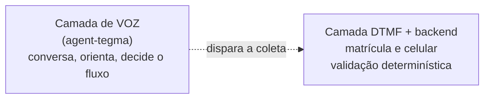

# Escopo do Sistema

## Modelo híbrido: voz conversacional + DTMF

A URA conversacional adota um **modelo híbrido** por decisão de segurança:

- A **conversa** (entender o pedido, guiar, responder) é feita por voz com o agente de IA
  **agent-tegma** (fala natural em pt-BR).
- Os **dados sensíveis** — matrícula (identidade) e celular (destino do SMS) — são coletados
  **exclusivamente por DTMF (teclado)** e validados no backend. A IA nunca recebe esses dígitos.

!!! quote "Regra de ouro"
    **A IA conversa, a IA não executa.** Quem valida identidade e envia o SMS é o backend,
    a partir de dígitos de teclado — nunca a partir do que foi dito por voz.

---

## O que o sistema FAZ

- Atende a ligação e cumprimenta o colaborador.
- Conversa, por voz, **somente sobre reset de senha** corporativa (Microsoft).
- Coleta **matrícula** e **celular** por DTMF; confirma o número.
- Verifica a matrícula na base de identidade (API da Cervello).
- Envia por **SMS** o **link oficial do portal Microsoft SSPR** (nunca a senha).
- Transfere para o **analista de plantão** quando é terceirizado, quando há falha, ou quando
  o interlocutor insiste em sair do escopo.

## O que o sistema NÃO FAZ

- Não fornece senha, não redefine senha diretamente, não cria senha temporária.
- Não aceita matrícula nem celular **ditados por voz**.
- Não responde a assuntos fora do reset de senha (o agente recusa e redireciona).
- Não executa ação alguma decidida “livremente” pela IA — só ações de uma lista fechada.
- Não expõe banco, API, mídia ou credenciais à internet.

---

## Limites da avaliação

Está no escopo da avaliação tudo que diz respeito a: atender ligações, conduzir a conversa de
reset, coletar/validar identidade por DTMF, enviar o SMS com o link oficial e transferir ao
atendente — além de toda a superfície de rede e infraestrutura que suporta isso. Qualquer
comportamento fora disso é, por projeto, recusado pelo agente e deve ser reportado se observado.
