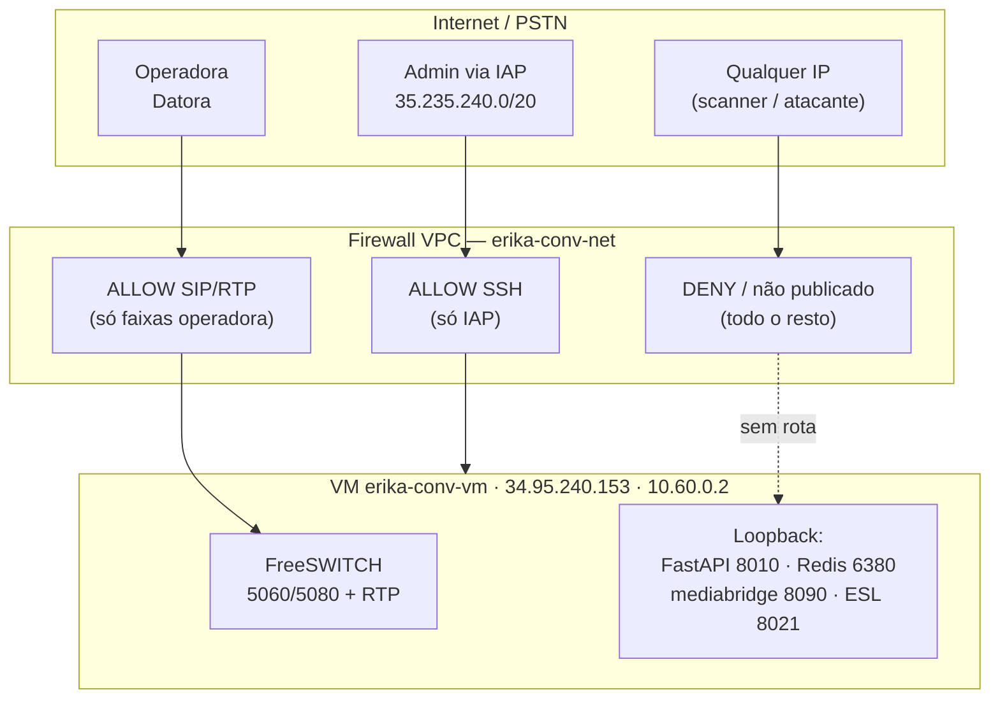

# Firewall e Perímetro

## Regras de firewall (VPC `erika-conv-net`)

| Regra | Direção | Porta/Protocolo | Origem | Ação |
|---|---|---|---|---|
| SIP operadora | entrada | `tcp/udp 5060, 5080` | Datora `187.60.60.0/24` | ALLOW |
| RTP (mídia) | entrada | `udp 16384-32768` | Faixa Datora `187.60.60.0/24` | ALLOW |
| SSH via IAP | entrada | `tcp 22` | IAP Google `35.235.240.0/20` | ALLOW |
| SNMP/RPC | entrada | `udp 161` / RPC | qualquer | DENY (explícito) |
| Default aberto (SSH/RDP) | entrada | `tcp 22 / 3389` | `0.0.0.0/0` | **REMOVIDA** |
| Demais | entrada | qualquer | qualquer | DENY (padrão) |

!!! note "Correção de higiene aplicada"
    As regras padrão `default-allow-ssh` e `default-allow-rdp` (abertas a `0.0.0.0/0`) foram
    **removidas**. A VM fica na VPC `erika-conv-net`; o acesso administrativo é **exclusivamente
    via IAP**.

---

## Topologia de perímetro

---

## Saída (egress)

A VM inicia conexões de **saída HTTPS** apenas para serviços necessários, e **SIP de saída**
pelo tronco para a transferência ao atendente:

| Destino | Uso | Proteção |
|---|---|---|
| Google Cloud (STT/TTS/Vertex) | Fala do agente | ADC (service account) — sem chave em disco |
| Cervello (API Macro) | Verificação de RE | HTTPS + Basic auth (cofre) |
| Twilio | SMS do link SSPR | HTTPS; corpo = só o link |
| Datora (tronco, saída) | Bridge p/ o plantão `(11) 2091-6450` | Mesmo tronco SIP da entrada |

A disponibilidade do tronco de entrada é monitorada por um **watchdog**: se o registro SIP cair,
ele re-registra (ou recria o serviço) automaticamente, evitando indisponibilidade silenciosa.
