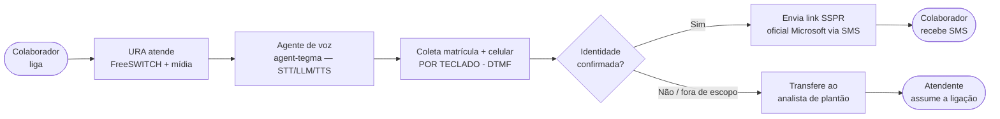

# URA Conversacional (agent-tegma) — Documentação de Segurança

**Documento técnico para avaliação de segurança da URA de autoatendimento por voz com IA.**

Esta documentação prepara a equipe de segurança do cliente para uma avaliação completa do
ambiente — testes de intrusão, varredura de portas e análise de superfície de ataque. É a
evolução da URA DTMF (documentada anteriormente): o atendimento agora é **conversacional por
voz com um agente de IA (agent-tegma)**, mas os dados sensíveis (matrícula e celular) continuam
sendo coletados por **teclado (DTMF)** e validados no backend — nunca pela IA. A segurança
permaneceu como requisito primário.

---

## Declaração de Boas-Vindas à Avaliação

!!! success "Scan e testes autorizados e incentivados"
    A equipe desenvolvedora **autoriza e encoraja** a realização de:

    - Varredura de portas (nmap, masscan)
    - Testes de intrusão SIP (sipvicious, svmap, svcrack)
    - Scan de aplicação web (nikto, OWASP ZAP, Burp Suite)
    - Tentativas de **prompt injection / jailbreak** por voz contra o agente
    - Tentativas de autenticação por força bruta / enumeração de matrícula
    - Análise de tráfego de rede

    O sistema foi construído para **resistir a esses ataques**. Esta documentação antecipa o
    que a equipe encontrará — e o que **não** encontrará.

---

## Resumo Executivo

| Dimensão | Estado |
|---|---|
| **Superfície de ataque externa** | Mínima — SIP restrito à faixa da operadora (Datora) e RTP (mídia de voz) |
| **SSH / acesso admin** | Zero exposição pública — exclusivamente via IAP do Google (autenticação 2FA) |
| **API / banco / mídia (WS/ESL)** | Somente loopback (`127.0.0.1`) — inacessível de qualquer ponto externo |
| **Portas TCP externas** | **Zero** acessíveis de IPs externos não autorizados |
| **Camada de IA (agent-tegma)** | A IA **conversa, não executa**: identidade e destino do SMS por DTMF + backend, nunca pela IA |
| **Guardrails do agente** | Bateria multi-turno anti-jailbreak/escopo: **16/16** |
| **Credenciais no código** | Zero — Google Secret Manager / `.env` fora do versionamento; ADC sem chave em disco |

---

## O que o sistema faz (escopo funcional)

O colaborador liga para um número fixo e **conversa** com o agente de voz para fazer o
**reset de senha Microsoft**, sem intervenção humana:

**Fora do escopo:** qualquer funcionalidade além de atender a ligação, conversar sobre o reset
de senha, coletar matrícula/celular por DTMF, enviar o SMS com o link oficial Microsoft e
transferir ao atendente. O agente recusa e redireciona qualquer assunto fora disso.

---

## Validação por ligação real

| Evento | Evidência |
|---|---|
| Entrada PSTN real (Datora) → URA conversacional | INVITE recebido e atendido; capturado por SIP trace |
| Reset completo (matrícula → identidade → SMS) | Matrícula validada na API da Cervello; SMS real entregue com o link SSPR |
| Guardrails (jailbreak, prompt injection, número por voz, fora de escopo) | Bateria automatizada multi-turno: 16/16 |
| Transferência ao analista de plantão (bridge) | Analista atende; chamador aguarda o toque na mesma ligação |
| Auto-recuperação do tronco | Watchdog re-registra o tronco SIP automaticamente se o registro cair |

---

## Navegação desta documentação

| Seção | Para quem |
|---|---|
| [Escopo do Sistema](escopo.md) | Entender o que o sistema faz e não faz |
| [Arquitetura e Topologia](modelagem/arquitetura.md) | Visão completa dos componentes e conexões |
| [Fluxo da Ligação (voz)](modelagem/fluxo-ligacao.md) | Como cada chamada por voz é processada |
| [Agente Conversacional e Guardrails](modelagem/agente.md) | Como o agente de IA é contido e por que não decide identidade/SMS |
| [Validação de Identidade](modelagem/autenticacao.md) | Como a identidade do chamador é verificada |
| [Superfície de Ataque](superficie-ataque.md) | O que está exposto e o que está fechado |
| [Camadas de Segurança](modelagem/seguranca.md) | Defense-in-depth em detalhe |
| [Firewall e Perímetro](firewall.md) | Regras de firewall GCP, topologia de rede |
| [Requisitos de Segurança](autenticacao-seguranca.md) | SEC-01..11 implementados e verificáveis |
| [Guia para Avaliadores](avaliacao-seguranca.md) | O que esperar de cada tipo de teste |
