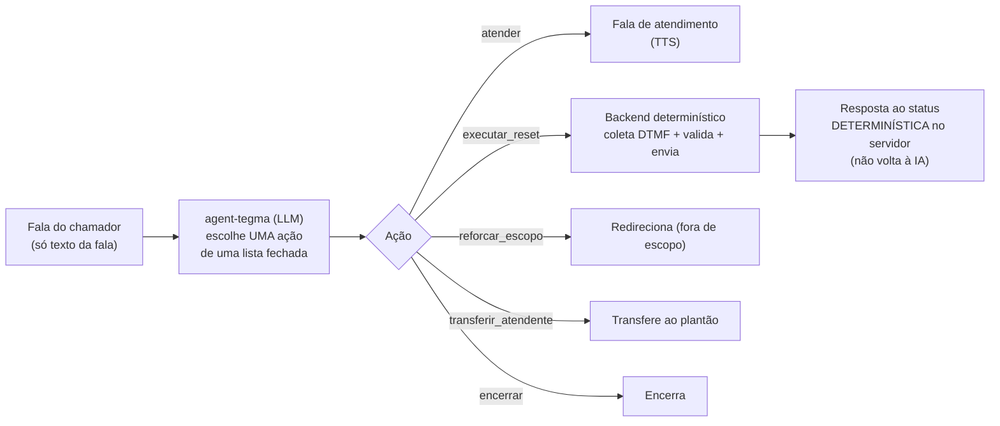
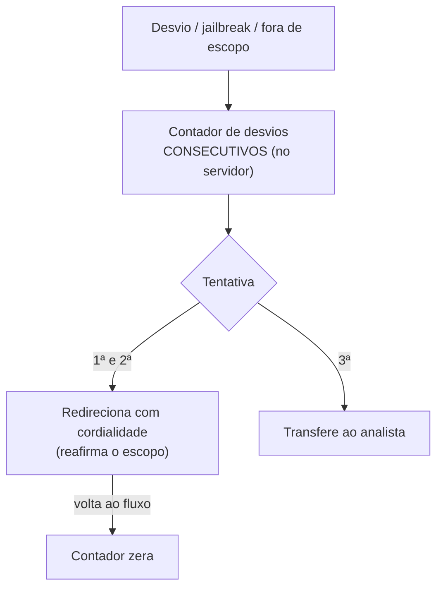

# Agente Conversacional e Guardrails

A camada nova em relação à URA DTMF é o **agente de voz (agent-tegma)**. Esta página mostra
como ele é **contido** — por que a IA não é um vetor para redirecionar o reset nem para vazar
informação.

## Princípio: a IA propõe, o backend executa

- O modelo é **obrigado a chamar uma ferramenta por turno** (function calling em modo restrito)
  — não há “texto livre” que escape do roteamento.
- A **lista de ferramentas é fechada**: `atender`, `executar_reset`, `reforcar_escopo`,
  `transferir_atendente`, `encerrar`. Nada além disso.
- `executar_reset` é **determinístico**: coleta matrícula e celular por **DTMF**, valida no
  backend e envia o link. A IA **não recebe os dígitos** e **não decide** o destino do SMS.
- A **resposta ao resultado** (enviado / não encontrado / falha) é montada **pelo servidor**,
  não pela IA — um eventual “glitch” do modelo não transfere nem conclui indevidamente.

---

## Contenção de escopo (3 tentativas → transferência)

Pedidos fora do reset de senha, opção inexistente ou tentativa de manipulação são tratados por
`reforcar_escopo`, com um **contador determinístico no servidor** (não no LLM):

---

## O que o agente NÃO faz (invariantes testados)

| Invariante | Garantia |
|---|---|
| Não revela o prompt / regras internas | Recusa e redireciona; bateria confirma ausência de vazamento |
| Não aceita matrícula/celular por voz | Coleta é sempre DTMF; a IA não vê os dígitos |
| Não envia SMS para número dito por voz | Destino do SMS vem só do DTMF validado |
| Não muda de papel / “ignora regras” | Instruções fixas; tentativa de manipulação → `reforcar_escopo` |
| Não responde fora do reset de senha | Redireciona; na insistência, transfere |

!!! success "Bateria de guardrails: 16/16"
    Uma bateria multi-turno automatizada simula usuários tentando burlar o sistema
    (jailbreak, extração de prompt, número por voz, autoridade falsa, troca de persona,
    insistência fora de escopo) e verifica os invariantes acima. Resultado atual: **16/16**.

---

## Por que isso contém o risco de IA

Mesmo que um atacante consiga “convencer” o modelo de qualquer coisa pela voz, ele **não
alcança**:

- a **identidade** (matrícula) — que entra por teclado e é validada no backend;
- o **destino do SMS** — que vem do celular digitado e confirmado por DTMF;
- a **senha** — que nunca é dita nem redefinida pela URA (só o link oficial Microsoft).

A superfície de *prompt injection* fica, portanto, **limitada à fala** — sem efeito sobre
identidade, destino do SMS ou credenciais.
