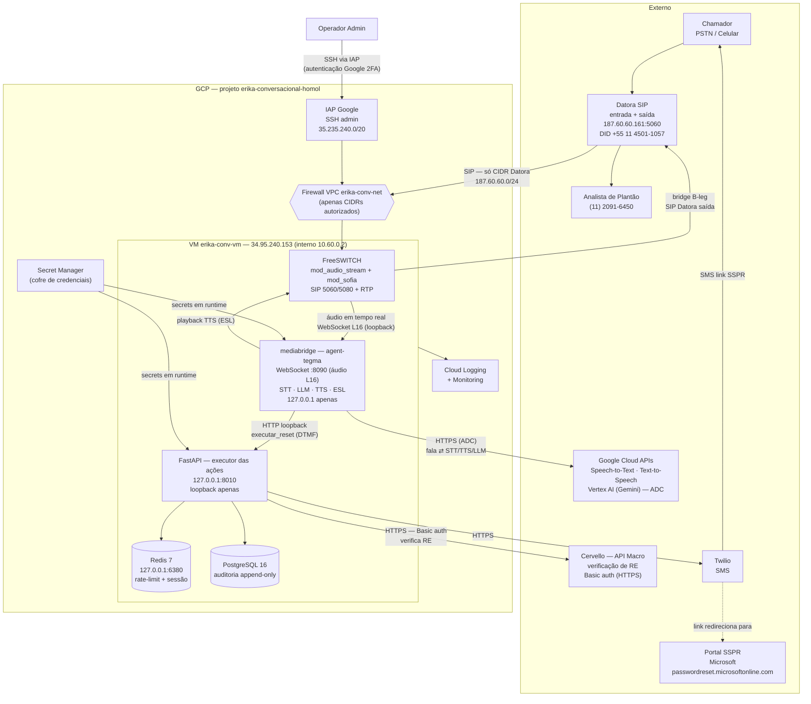
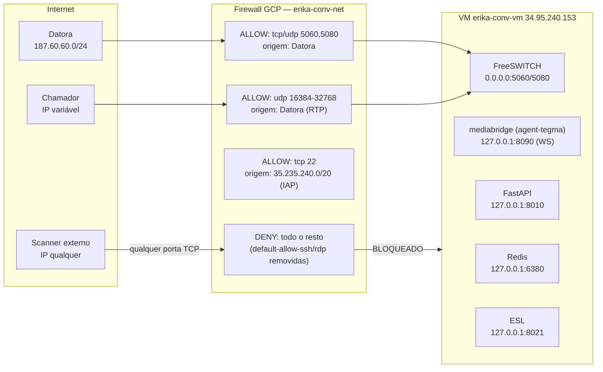
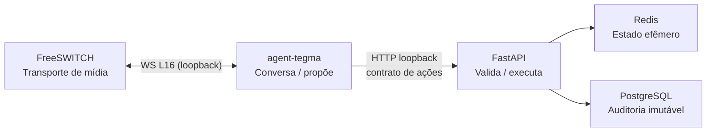

# Arquitetura e Topologia

## Diagrama de Arquitetura Completo

!!! note "A regra de ouro desta arquitetura"
    A IA (**agent-tegma**) recebe **apenas a fala** do chamador e escolhe ações de uma
    **lista fechada**. A **matrícula e o celular** chegam por **DTMF (teclado)** e são
    validados pelo FastAPI — a IA **nunca** vê os dígitos nem decide identidade ou destino do
    SMS. Logo, não há caminho para *prompt injection* redirecionar o reset.

---

## Topologia de rede

---

## Componentes internos

| Componente | Função | Escuta em | Acessível externamente? |
|---|---|---|---|
| **FreeSWITCH** | Telefonia — atende SIP, mídia RTP, `mod_audio_stream`, bridge | `0.0.0.0:5060/5080` (SIP) | Apenas da faixa Datora |
| **mediabridge (agent-tegma)** | Ponte de mídia + agente: STT, LLM, TTS, ESL; WebSocket de áudio | `127.0.0.1:8090` (WS) · ESL `127.0.0.1:8021` | **Não** |
| **FastAPI** | Executor das ações — valida RE, rate limit, envia o link | `127.0.0.1:8010` | **Não** |
| **Redis** | Rate limiting + estado efêmero | `127.0.0.1:6380` | **Não** |
| **PostgreSQL** | Auditoria imutável | interno | **Não** |

---

## Separação de responsabilidades

O design segue a **separação estrita** — reforçada pela regra de ouro da camada de IA:

- **FreeSWITCH** atende a ligação e transporta a mídia — **não toma decisões**.
- **mediabridge / agent-tegma** conduz a conversa (STT→LLM→TTS) e **propõe** ações de uma lista
  fechada — **não executa** nem recebe os dígitos sensíveis.
- **FastAPI** toma e executa as decisões (valida RE, coleta DTMF, envia o link) — **nunca exposto**.
- **Redis** guarda estado temporário com TTL — **sem PII persistida**.
- **PostgreSQL** registra auditoria imutável — **matrícula apenas em hash**.

Mesmo que o FreeSWITCH **ou** o agente de IA sejam manipulados, o atacante não alcança a
lógica de negócio, o banco ou as credenciais — tudo fica no loopback interno, e identidade e
destino do SMS só se resolvem por DTMF validado no FastAPI.
