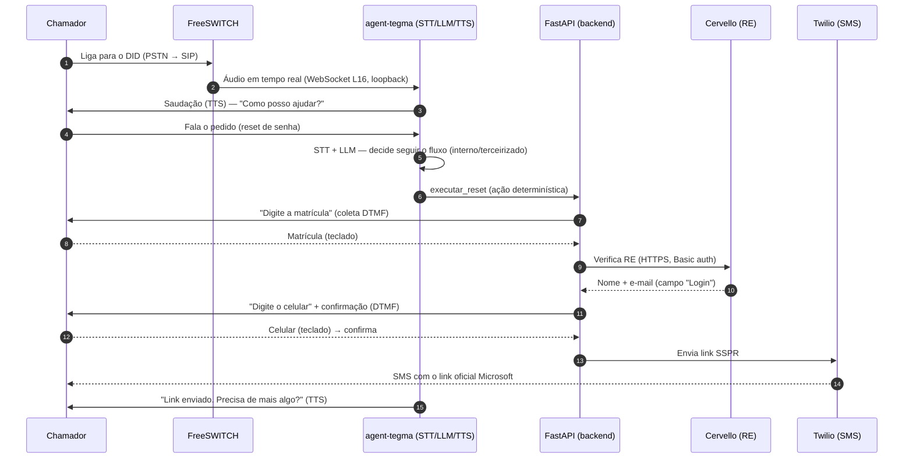
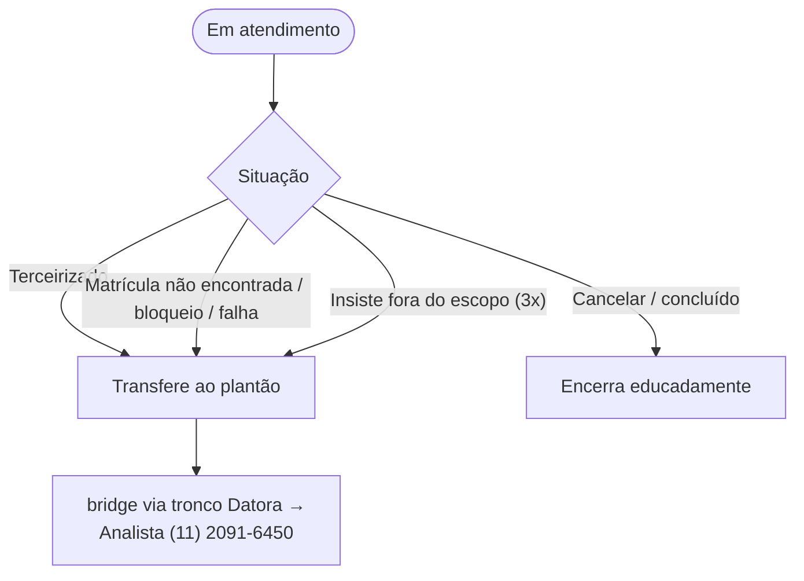

# Fluxo da Ligação (voz)

## Visão de alto nível

---

## Etapas e controles

| # | Etapa | Controle de segurança |
|---|---|---|
| 1 | Entrada da chamada | Firewall + ACL SIP: só as faixas da operadora chegam ao FreeSWITCH |
| 2 | Mídia para o agente | WebSocket **em loopback**; nenhuma porta de mídia exposta |
| 3 | Conversa (STT/LLM/TTS) | A IA só recebe **fala**; escolhe ações de uma **lista fechada**; guardrails anti-jailbreak |
| 4 | Coleta de matrícula | **DTMF**, não voz; validada no backend; rate limit por matrícula+ANI |
| 5 | Verificação de identidade | Cervello via **HTTPS + Basic auth**; mensagem genérica em erro (anti-enumeração) |
| 6 | Coleta/confirmação do celular | **DTMF**; confirmação dos últimos dígitos; nunca aceita número por voz |
| 7 | Envio do link | **Só o link** do portal Microsoft SSPR (SEC-01); nunca a senha |
| 8 | Encerramento/fim | Resposta de sucesso **determinística** no servidor (não deixada à IA) |

---

## Saídas alternativas (contingência)

A transferência é feita por **bridge** pelo tronco SIP de saída: o chamador permanece na mesma
ligação ouvindo o toque até o atendente atender. Limites anti-abuso (teto de turnos e de
duração da ligação) também levam, no limite, à transferência segura.
