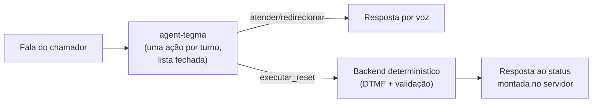
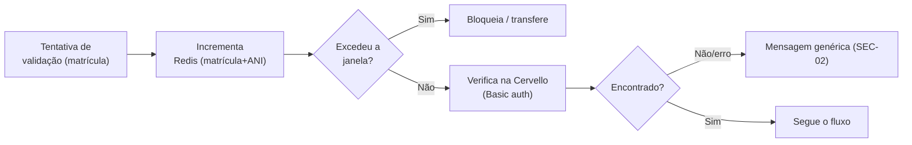
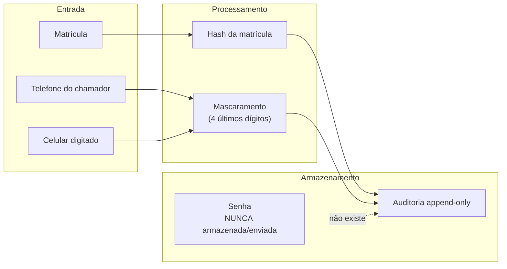
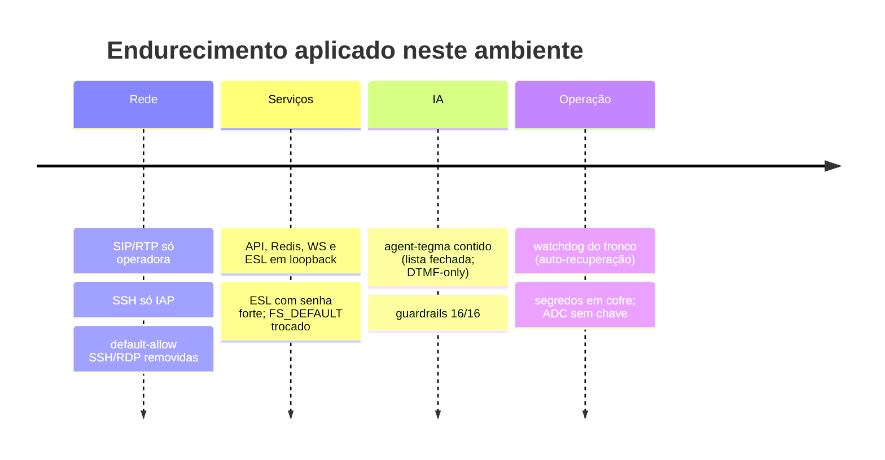

# Camadas de Segurança

## Visão geral — Defense-in-Depth

O sistema implementa **camadas de segurança independentes**. O comprometimento de uma camada
isolada não compromete o conjunto — e a camada de IA é contida de forma que nem a manipulação
do agente alcança identidade, destino do SMS ou credenciais.

```mermaid
flowchart TB
    subgraph L1["Camada 1 — Rede e Firewall GCP"]
        N1["SSH só via IAP\n35.235.240.0/20"]
        N2["SIP só faixa operadora\nDatora"]
        N3["API, Redis, WS, ESL\nem loopback (127.0.0.1)"]
        N4["Default-allow SSH/RDP\nremovidas"]
    end
    subgraph L2["Camada 2 — FreeSWITCH endurecido"]
        FS1["ESL em 127.0.0.1\n+ senha forte"]
        FS2["FS_DEFAULT_PASSWORD\ntrocado"]
        FS3["ACL SIP\nsó operadora"]
        FS4["epmd confinado\nao loopback"]
    end
    subgraph L3["Camada 3 — IA contida (agent-tegma)"]
        AI1["IA propõe,\nnão executa"]
        AI2["Lista fechada\nde ferramentas"]
        AI3["Identidade e SMS\npor DTMF (não pela IA)"]
        AI4["Guardrails anti-jailbreak\n16/16"]
    end
    subgraph L4["Camada 4 — Autenticação e Rate Limiting"]
        A1["Verificação de RE\n(Cervello, Basic auth)"]
        A2["Rate limit Redis\npor matrícula+ANI"]
        A3["Mensagem genérica\nanti-enumeração (SEC-02)"]
    end
    subgraph L5["Camada 5 — Aplicação"]
        AP1["Entrada DTMF\nsó dígitos"]
        AP2["Backend nunca\nexposto (loopback)"]
        AP3["Sem exposição de\nversão/ambiente"]
    end
    subgraph L6["Camada 6 — Proteção de Dados / LGPD"]
        D1["PII mascarada\nnos logs"]
        D2["Matrícula em hash"]
        D3["Audit append-only"]
        D4["Senha NUNCA\narmazenada ou enviada"]
    end
    subgraph L7["Camada 7 — Segredos"]
        S1["Secret Manager / .env\nfora do versionamento"]
        S2["ADC (Google)\nsem chave em disco"]
    end
    subgraph L8["Camada 8 — Trânsito e Infra"]
        T1["SSH via IAP (cifrado)"]
        T2["Saídas HTTPS\n(Google, Cervello, Twilio)"]
        T3["Disco GCP\ncifrado em repouso"]
    end
    subgraph L9["Camada 9 — Observabilidade"]
        O1["Cloud Logging (JSON)"]
        O2["Audit trail de\ncada interação"]
        O3["Watchdog do tronco\n(auto-recuperação)"]
    end
    L1 --> L2 --> L3 --> L4 --> L5 --> L6 --> L7 --> L8 --> L9
```

---

## Camada 1 — Firewall GCP

| Proteção | Implementação |
|---|---|
| SSH não exposto | Porta 22 só do IAP `35.235.240.0/20`; default-allow-ssh/rdp removidas |
| SIP restrito | 5060/5080 só da faixa Datora `187.60.60.0/24` |
| API invisível | FastAPI em `127.0.0.1:8010` — loopback |
| Redis invisível | `127.0.0.1:6380` — loopback |
| Mídia/controle invisível | mediabridge WS `127.0.0.1:8090` e ESL `127.0.0.1:8021` — loopback |

---

## Camada 2 — FreeSWITCH endurecido

| Proteção | Implementação |
|---|---|
| ESL com senha forte | `ESL_PASSWORD` via cofre; escuta em `127.0.0.1:8021` |
| Credenciais demo removidas | `FS_DEFAULT_PASSWORD` trocado — bloqueia registro padrão |
| ACL de entrada | `SIP_INBOUND_ACL` — só as faixas da operadora no perfil externo |
| Erlang confinado | epmd restrito ao loopback |

---

## Camada 3 — IA contida (agent-tegma)

A camada nova em relação à URA DTMF. Detalhe completo em
[Agente Conversacional e Guardrails](agente.md).

| Proteção | Implementação |
|---|---|
| IA propõe, não executa | O modelo só escolhe de uma lista fechada; quem executa é o backend |
| Sem dígitos para a IA | Matrícula e celular por DTMF; a IA não os recebe |
| Contenção de escopo | 3 desvios consecutivos → transferência (contador no servidor) |
| Guardrails | Bateria multi-turno anti-jailbreak/escopo: 16/16 |

---

## Camada 4 — Autenticação e Rate Limiting

---

## Camada 6 — Proteção de Dados e LGPD

!!! note "Destino do SMS"
    O SMS é enviado ao **celular digitado e confirmado por DTMF** — nunca a um número dito por
    voz e nunca escolhido pela IA. Recomendação de evolução: conferir os últimos dígitos contra
    o celular **cadastrado** antes do envio (2º fator).

---

## Postura de hardening (estado atual)

