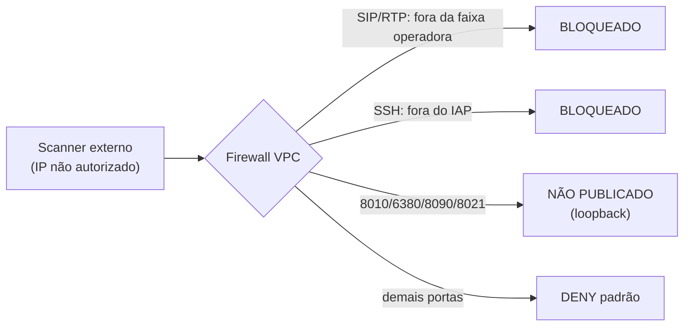

# Superfície de Ataque

## Alvo (acesso inicial)

| Item | Valor |
|---|---|
| **IP público (alvo)** | `34.95.240.153` |
| Número de entrada (DID) | `+55 11 4501-1057` |
| VM / zona | `erika-conv-vm` · `southamerica-east1` |
| IP interno | `10.60.0.2` · VPC `erika-conv-net` (`10.60.0.0/24`) |

## O que está exposto no IP público

| Porta / vetor | Serviço | Origem permitida | De um IP arbitrário |
|---|---|---|---|
| `udp 5060, 5080` (SIP) | FreeSWITCH (tronco) | Faixa Datora `187.60.60.0/24` | **BLOQUEADO** |
| `udp 16384-32768` (RTP) | Mídia de voz | Mesmas faixas da operadora | **BLOQUEADO** |
| `tcp 22` (SSH) | Administração | Somente IAP `35.235.240.0/20` | **BLOQUEADO** |
| `tcp 8010` / `6380` | FastAPI / Redis | Somente loopback `127.0.0.1` | **NÃO EXPOSTO** |
| `tcp 8090` (WS) / `8021` (ESL) | mediabridge / FreeSWITCH | Somente loopback `127.0.0.1` | **NÃO EXPOSTO** |
| DID `+55 11 4501-1057` | URA (voz) | Qualquer telefone (PSTN) | **Camada de aplicação** |

!!! warning "Leitura para a equipe"
    Pela rede, a superfície externa é mínima: SIP/RTP só aceitam as faixas da operadora e o SSH
    só o IAP; o restante é loopback. O **caminho de ataque realista é a camada de aplicação** —
    discar o DID e exercitar a URA (guardrails, DTMF, injeção por voz). Veja
    [Agente Conversacional e Guardrails](modelagem/agente.md).

---

## O que está fechado

- **Backend, Redis, WebSocket de mídia e ESL**: apenas `127.0.0.1` — nenhum alcance externo.
- **SSH**: sem exposição pública; só via IAP com autenticação Google.
- **Regras default abertas** do VPC (`default-allow-ssh`, `default-allow-rdp`) **removidas**.
- **Segredos**: nenhum no código/repositório; cofre/`.env`; ADC sem chave.

---

## Camada de aplicação (onde o teste é mais relevante)

O vetor de maior interesse é a própria URA, via ligação:

- **Prompt injection / jailbreak por voz** contra o agent-tegma → deve ser recusado/redirecionado,
  sem vazar prompt e sem efeito sobre identidade/SMS.
- **Número/matrícula por voz** → ignorado; coleta é só DTMF.
- **Enumeração de matrícula** → mensagem genérica + rate limit.
- **Abuso de SMS** → rate limit por matrícula+ANI; corpo do SMS traz só o link oficial.
